# Phishing Simulation Documentation

## Overview

This documents a controlled phishing simulation conducted in an isolated lab 
environment against dummy accounts I own. The goal was to replicate the exact 
tactics used in real Singapore-themed phishing attacks like fake IRAS tax refunds, 
Singpass resets, and SingPost delivery notices— and demonstrate what an attacker 
actually captures when a victim clicks and submits credentials.

No real users were targeted. All email addresses used were dummy accounts or 
plus-aliases of a single test inbox. This simulation was conducted entirely within 
a Kali Linux VM using GoPhish, an open-source phishing simulation framework.

**NOTE: 100% RATES (in this documentation) REFLECT A SINGLE CONTROLLED TEST AGAINST DUMMY ACCOUNTS I OWN. REAL-WORLD SIMULATION RESULTS MAY VERY!!!**

---

## Environment

| Tool | Purpose |
|------|---------|
| VMware Workstation Player | Virtualisation — isolated environment so simulation never touches real network traffic |
| Kali Linux | Attacker OS — industry standard for penetration testing |
| GoPhish v0.12.1 | Phishing simulation framework — manages email sending, landing pages, and result tracking |
| Mailtrap | SMTP sandbox — catches outgoing emails safely without delivering to real inboxes |

---

## Setup

### Step 1 — Install Kali Linux

Downloaded the pre-built VMware image from kali.org and imported the `.vmx` file 
into VMware. Default user and password is  kali/kali, changed immediately using `passwd` to make it more secure

Updated all packages before starting:

```bash
sudo apt update && sudo apt upgrade -y
```

`apt update` refreshes the package list from Kali's repositories so everything is up to date!  
`apt upgrade -y` installs all available updates. The `-y` flag auto-confirms 
so it doesn't pause to ask permission for every package which would take ages.

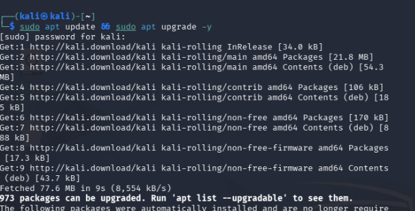
---

### Step 2 — Install GoPhish

Downloaded the GoPhish binary directly from GitHub releases:

```bash
wget https://github.com/gophish/gophish/releases/download/v0.12.1/gophish-v0.12.1-linux-64bit.zip
unzip gophish-v0.12.1-linux-64bit.zip -d gophish
cd gophish
chmod +x gophish
sudo ./gophish
```

`wget` downloads the file from the URL.  
`unzip -d gophish` extracts it into a folder called gophish.  
`chmod +x gophish` makes the binary executable — without this Linux won't run it since one of its security rule is that it won't automatically run files as programs so that means without this gophish won't have the execute permission
`sudo ./gophish` runs GoPhish with root privileges. Sudo is required because 
GoPhish listens on port 80 (the phishing server) and ports below 1024 require 
root on Linux.
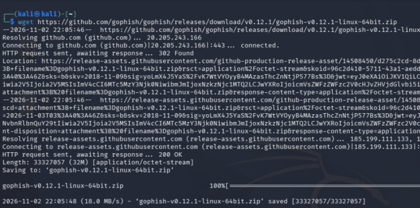
---
On first run, GoPhish prints a temporary admin password in the terminal:

login with the username admin and the password 10046c83b399489a

This is a one-time password that must be changed on first login for better security!!
GoPhish starts two servers simultaneously:
- `https://127.0.0.1:3333` — the admin panel where campaigns are managed
- `http://0.0.0.0:80` — the phishing server that victims connect to

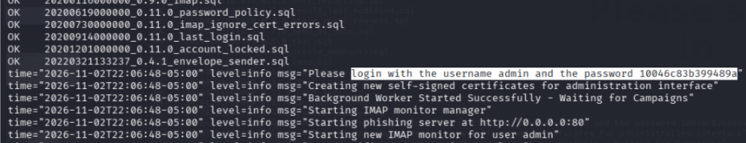
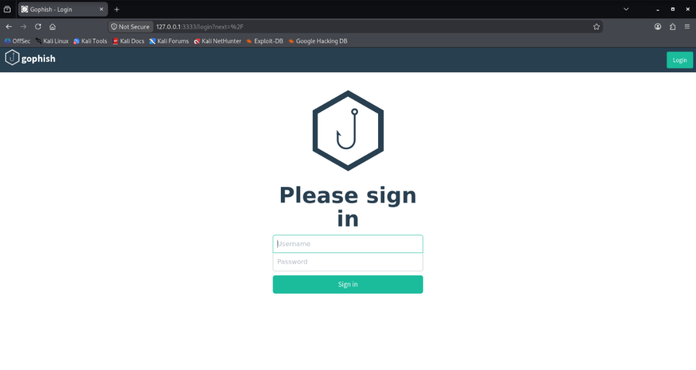
---

### Step 3 — Configure SMTP with Mailtrap

Rather than using a real SMTP server (which risks accidentally delivering phishing 
emails to real inboxes...oh and doing it with a real inbox might also be illegal), Mailtrap was used as a sandbox. Mailtrap intercepts all outgoing mail and displays it in a fake inbox; nothing is ever delivered externally since well— that would be illegal.

GoPhish Sending Profile settings:
Host: sandbox.smtp.mailtrap.io:2525
Username: [mailtrap username]
Password: [mailtrap password]
From: IRAS Tax Department sgtargettesting@gmail.com

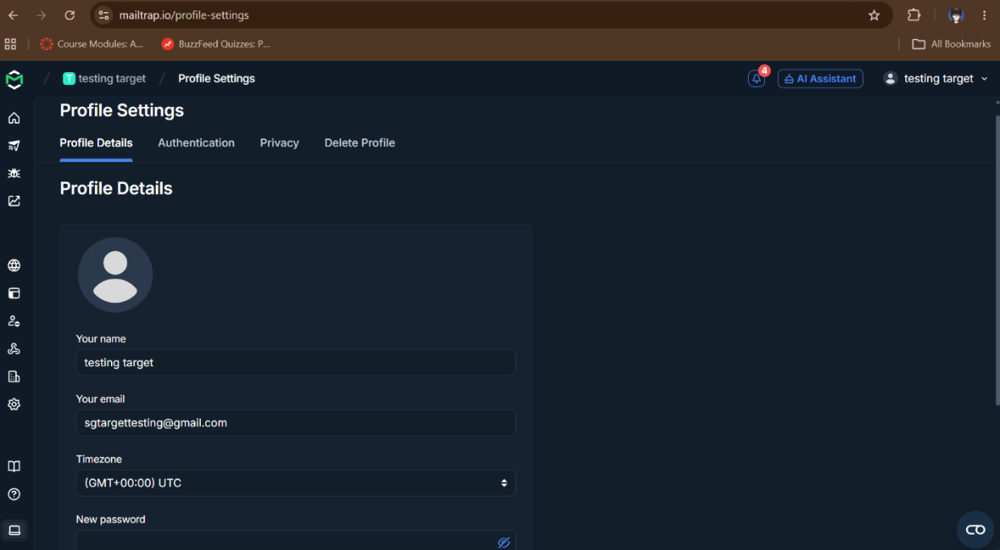
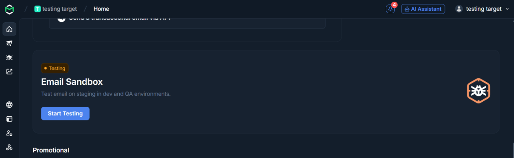
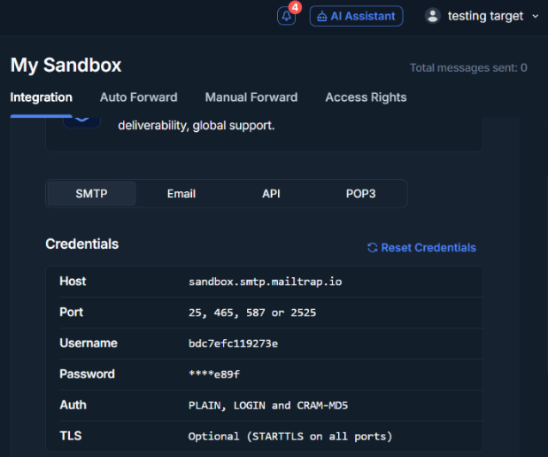

The `From` field demonstrates display name spoofing— the recipient sees 
"IRAS Tax Department" as the sender name, but the actual sending address is 
a Gmail account. This is one of the most common phishing techniques because 
most email clients display only the name, not the address.

**Red flag for victims:** Always click the sender name to expand and verify 
the actual email address. `iras@gmail.com` is not a government email address since impersonating a member of the government would be illegal and I'm too poor to afford bail! 
---

### Step 4 — Create Target Group

Created a group of three dummy targets using plus-alias addressing, we probably won't need these since we're using mailtrap but I wanted to show off a little something I (was forced to) learned because google hates it when you spam create multiple accounts:

sgtargettesting@gmail.com
sgtargettesting+victim2@gmail.com
sgtargettesting+victim3@gmail.com

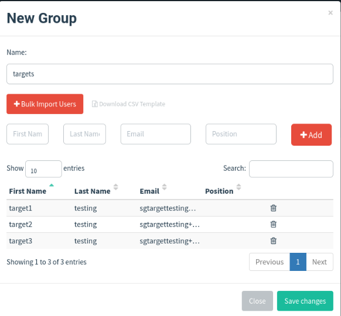

Gmail delivers all plus-alias variations to the same inbox, so only one real 
account was needed. GoPhish, however treats each address as a separate target and tracks 
them individually.
---

### Step 5 — Build Phishing Email Template

Created an email template mimicking an IRAS tax refund notification:

Subject: You have a tax refund of $382.00 pending
From: IRAS Tax Department

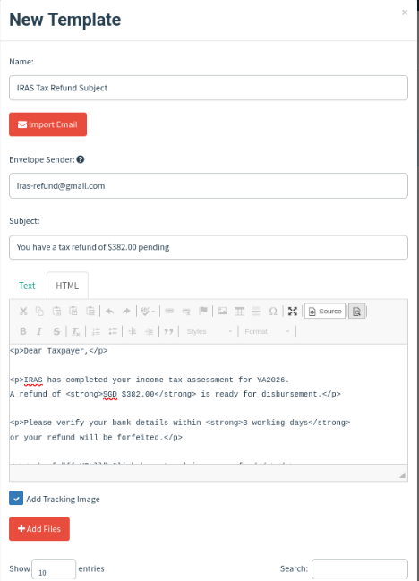

The email body contained:
- A specific dollar amount (SGD $382.00) to create urgency and credibility
- A 3-day deadline to pressure the victim into acting without thinking
- A `{{.URL}}` tracking link that GoPhish replaces this automatically with a 
 unique URL per target, allowing it to track exactly who clicked

The **Add Tracking Image** option embeds a 1x1 invisible pixel in the email. 
When the email is opened, the pixel loads from GoPhish's server and logs the 
open event— the victim has no idea this happened since it's invisible from their end.
---

### Step 6 — Build Landing Page

Created a fake IRAS login page as the credential harvesting page, this is the basic html for the page with no styling, the most important thing is the submit button! :

```html
<html>
<body>
<h2>IRAS MyTax Portal</h2>
<p>Your refund of SGD $382.00 is ready. Please verify your identity.</p>
<form action="/" method="POST">
  NRIC: <input type="text" name="username"><br><br>
  Password: <input type="password" name="password"><br><br>
  <button type="submit">Submit</button>
</form>
</body>
</html>
```
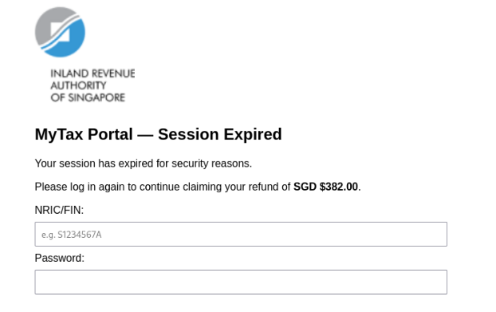


GoPhish's **Capture Submitted Data** and **Capture Passwords** options were 
enabled. When a victim submits the form, GoPhish logs everything they typed— 
including plaintext passwords — and stores it in the campaign results.
---

### Step 7 — Launch Campaign

Campaign settings:

Email Template: IRAS Tax Refund
Landing Page: IRAS Refund Portal
URL: http://127.0.0.1
Sending Profile: Gmail Burner (Mailtrap)
Group: targets
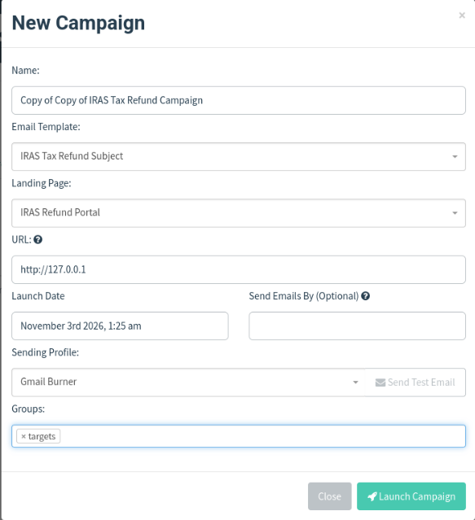
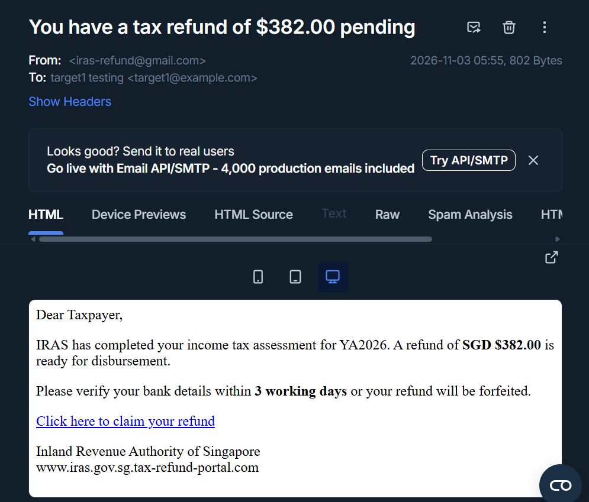

The URL field tells GoPhish what base URL to use when generating the 
`{{.URL}}` tracking links. Since this is a local simulation, `127.0.0.1` 
points to GoPhish's own phishing server running on port 80 so GoPhish is able to catch that request, logs that the user clicked, and records it in your dashboard.
---

## dun dun DUNN Results!

| Metric | Result |
|--------|--------|
| Emails Sent | 1 |
| Emails Opened | 1 |
| Links Clicked | 1 |
| Credentials Submitted | 1 |

**100% click-through rate and 100% credential submission rate** on the target 
who received the email.

GoPhish captured the following from the form submission:
- NRIC field contents (submitted as test data)
- Password field contents in plaintext

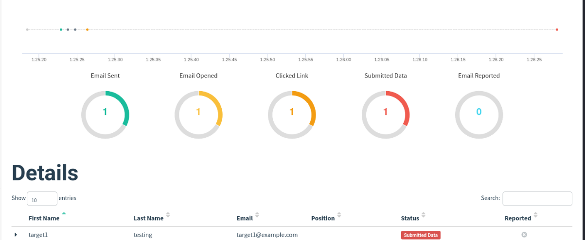
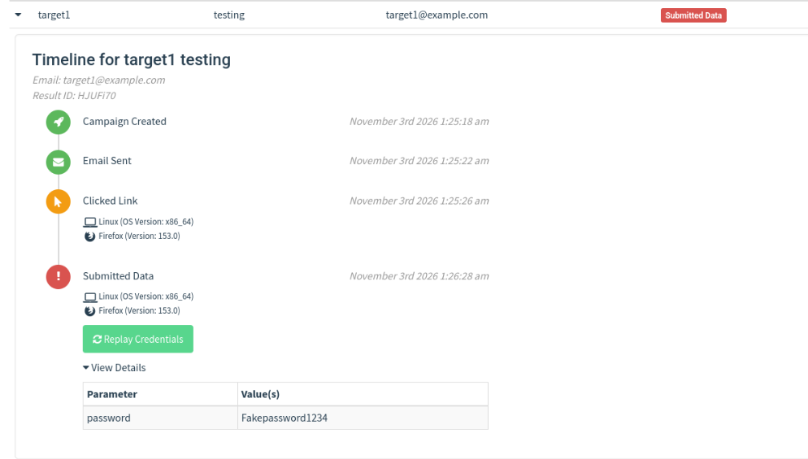

This demonstrates the complete phishing kill chain:
1. Victim receives convincing email from "IRAS Tax Department"
2. Victim opens email (tracked via invisible pixel)
3. Victim clicks link (tracked via unique URL)
4. Victim submits credentials on fake login page
5. Attacker has username and password; victim has no idea

---

## What This Proves

**Display name spoofing works.** The sender showed as "IRAS Tax Department" 
despite coming from a Gmail address. Non-technical users almost never check 
the actual sending address.

**Urgency is effective.** A specific refund amount with a 3-day deadline 
creates pressure to act without thinking critically.

**The tracking pixel is invisible.** Email open events are logged silently 
with no indication to the recipient.

---

## Defensive Takeaways

- Always verify the actual sender email address, not just the display name
- Government agencies (IRAS, Singpass, CPF) will never ask for credentials via email
- When in doubt, navigate directly to the official site— never click email links
- Enable MFA where possible— even if credentials are stolen, MFA adds a barrier
- Report suspicious emails to your IT team or CSA's SingCERT

---
## Campaign 2 and 3 disclaimers: creating the email template and landing pages were the same process as campaign 1 so the analysis of the following two campaigns will be less about set up and more about results!
---

## Campaign 2 — Singpass Account Suspension

### Let's lure!
target is to be sent a fake Singpass email warning the target that their account will be 
suspended in 24 hours due to suspicious activity.
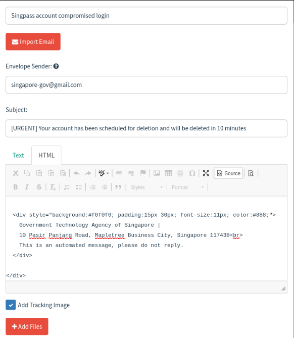

### What the email looked like
- Sender displayed as "Singpass" despite coming from a Gmail address
- Official red Singpass branding (#e2231a colour code)
- "A Singapore Government Agency Website" banner— mimicking the real 
  trust indicator that appears on actual gov.sg sites
- Listed specific services at risk: CPF, IRAS, NS Portal, HDB transactions
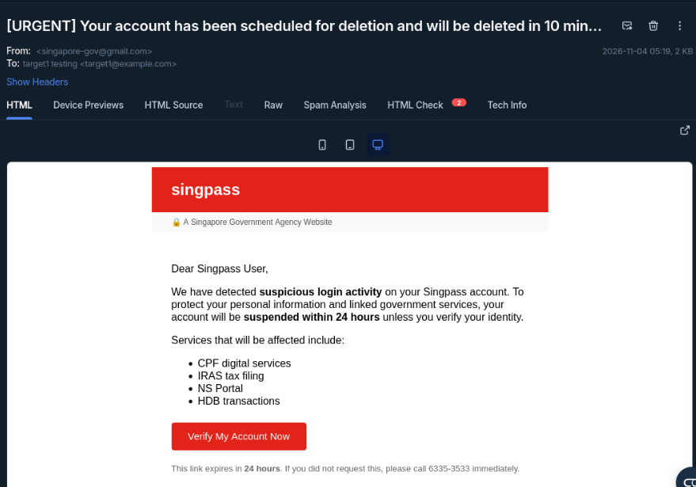

### What the landing page looked like/ captured:
A fake Singpass login page collecting:
- NRIC/FIN number
- Password

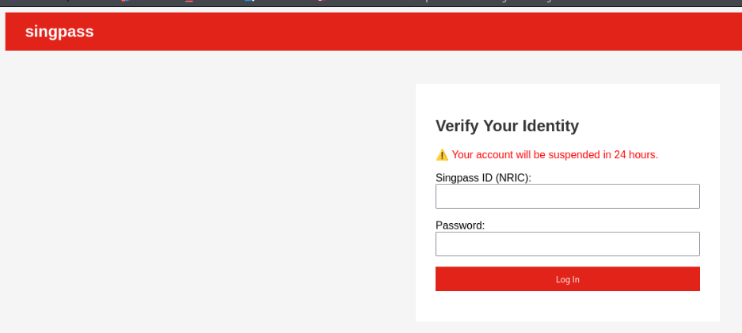
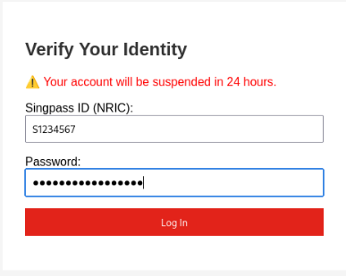

### What a real attacker walks away with
Full Singpass credentials. And since singpass is the master key to almost every 
Singapore government digital service— CPF, IRAS, HDB, NS Portal, 
healthcare records. One set of stolen Singpass credentials gives an 
attacker access to a victim's entire digital identity in Singapore.

### Results
| Metric | Result |
|--------|--------|
| Emails Sent | 1 |
| Emails Opened | 1 |
| Links Clicked | 1 |
| Credentials Submitted | 1 |
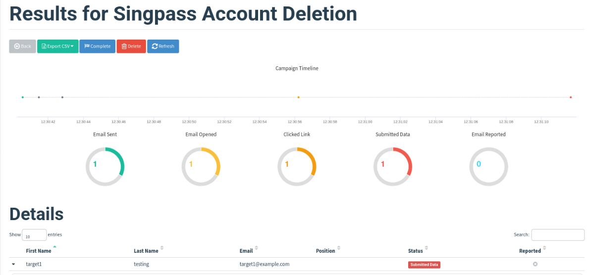
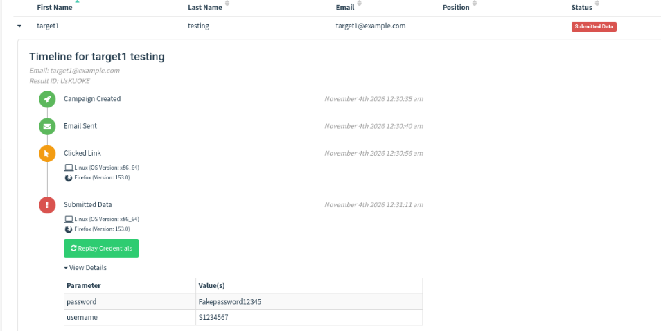
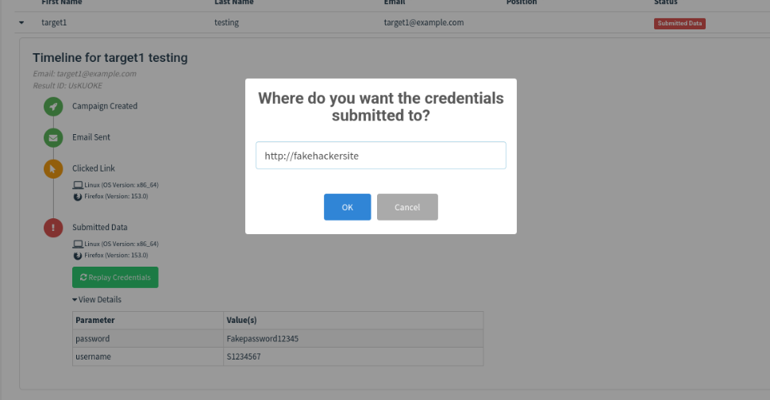
---

## Campaign 3 — SingPost Failed Delivery

### Lure
A fake SingPost notification claiming a parcel could not be delivered 
and requesting a SGD $50.95 redelivery fee within 48 hours.

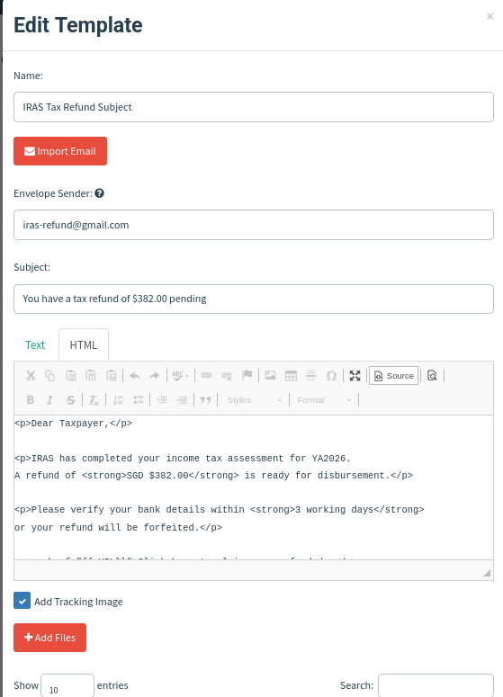

### What the email looked like
- Sender displayed as "SingPost" 
- Fake but realistic tracking number (SP-7739204)
- Specific dollar amount— $50.95 feels too specific to question
- 48-hour deadline creating urgency without feeling extreme
- Real-looking parcel details table with status showing "Delivery Failed"
- Legitimate-looking Singapore Post address in footer

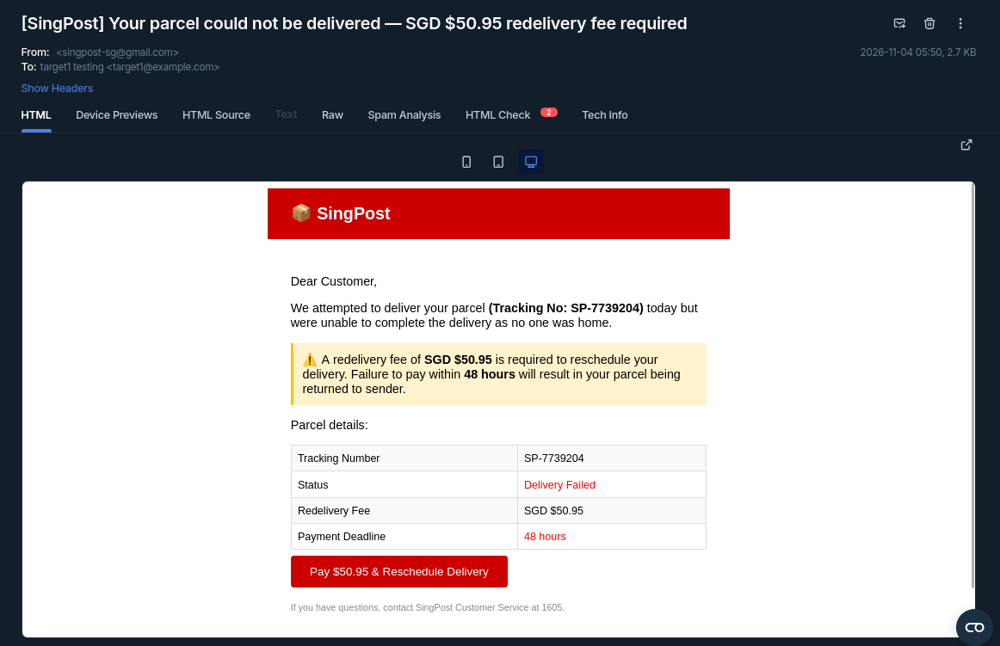

### What the landing page captured
A fake payment page collecting:
- Full name
- Credit/debit card number
- Expiry date
- CVV
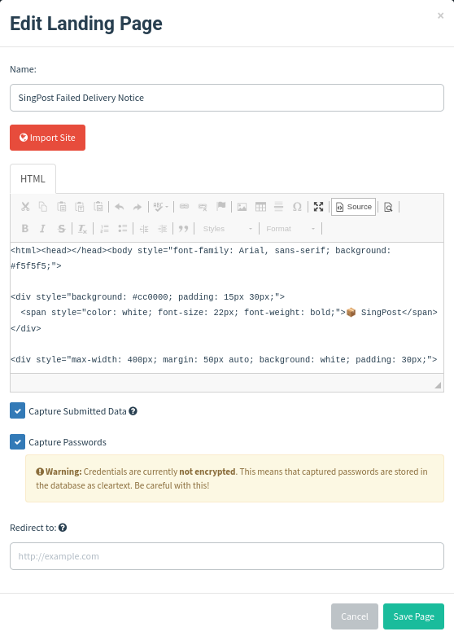
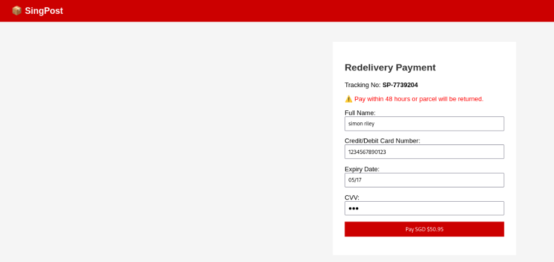

### What a real attacker walks away with
Full payment card details. Unlike the IRAS and Singpass campaigns which 
target account credentials, this campaign targets financial data directly. 
The attacker can immediately use or sell the card details.

### Results
| Metric | Result |
|--------|--------|
| Emails Sent | 1 |
| Emails Opened | 1 |
| Links Clicked | 1 |
| Data Submitted | 1 |

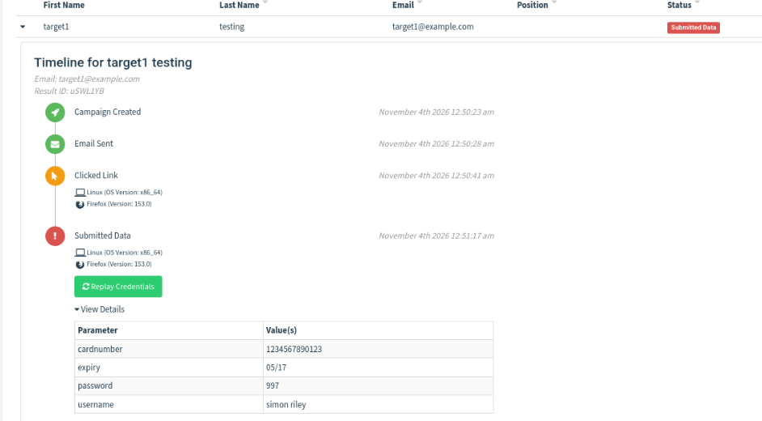
---